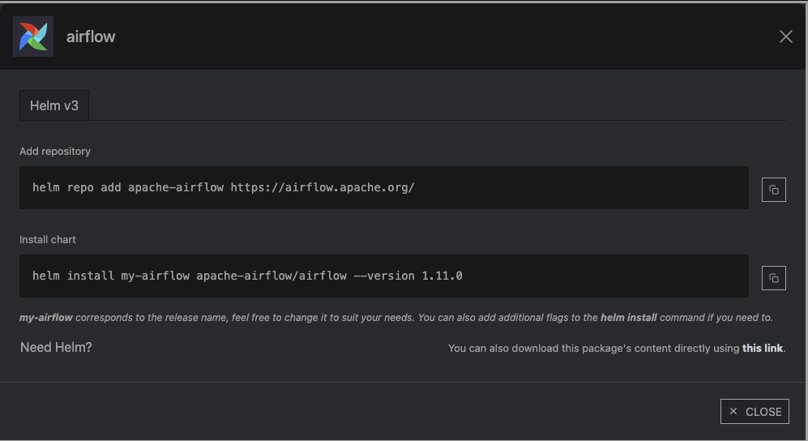
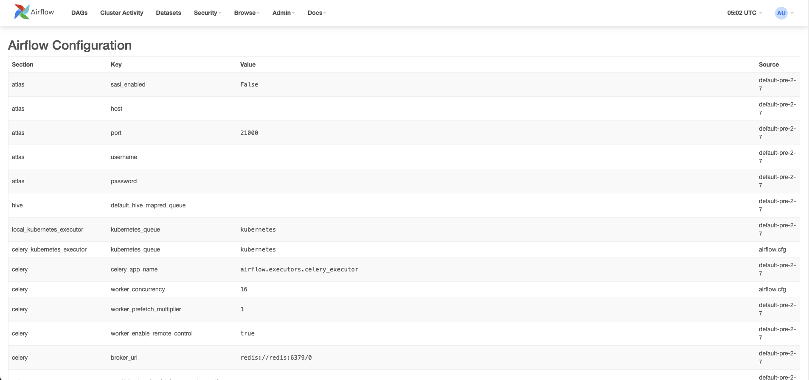

# Apache Airflow 배포 및 운영 가이드 (KubernetesExecutor & Git-Sync)

Kubernetes 환경에서 공식 Helm 차트로 **Apache Airflow**를 배포하고, **KubernetesExecutor**를 통한 동적 파드 실행 및 **Git-Sync**를 활용한 DAG 자동 동기화, 그리고 ArgoCD GitOps 배포 시 Helm Hook 이슈를 해결한 실무 가이드입니다.

---

## 1. Helm Repository 등록 및 기본 설치 명령어

공식 Apache Airflow Helm 저장소를 사용합니다. [ArtifactHub 공식 문서](https://artifacthub.io/packages/helm/apache-airflow/airflow)

```bash
helm repo add apache-airflow https://airflow.apache.org/
helm repo update

# 기본 설치 예시
helm install my-airflow apache-airflow/airflow --version 1.11.0

# 커스텀 values 파일 적용 설치
helm install airflow apache-airflow/airflow --version 1.11.0 -f values.yaml -n airflow --create-namespace
```



---

## 2. 실무 `values.yaml` 핵심 설정

> [!IMPORTANT]
> **실무 핵심 포인트**
> 1. **ArgoCD 배포 시 Hook 이슈**: ArgoCD는 Helm Hook의 라이프사이클을 온전히 따르지 않으므로 `createUserJob` 및 `migrateDatabaseJob`의 `useHelmHooks: false`로 설정하고 ArgoCD Sync Hook 어노테이션을 부여해야 DB 마이그레이션과 유저 생성이 정상 수행됩니다.
> 2. **DAG 동기화 방식**: RWO(ReadWriteOnce) 블록 스토리지는 여러 파드(웹서버, 스케줄러, 워커) 간 동시 마운트가 안 되고 NAS 볼륨도 클라우드 환경에 따라 불안정할 수 있어, Git 레포지토리를 주기적으로 폴링하는 **Git-Sync 사이드카 방식**이 가장 안정적입니다.
> 3. **실행 엔진 (Executor)**: 대규모 배치 및 격리 환경을 위해 워크플로우 태스크마다 파드를 동적으로 띄우는 **`KubernetesExecutor`**를 사용합니다.

```yaml
# ArgoCD 등록 시 Helm Hook 미동작 방지 설정
createUserJob:
  useHelmHooks: false
  applyCustomEnv: false
migrateDatabaseJob:
  useHelmHooks: false
  applyCustomEnv: false
  jobAnnotations:
    "argocd.argoproj.io/hook": Sync
useStandardNaming: true

# 웹서버 시크릿 키 (openssl rand -hex 16 등으로 생성)
webserverSecretKey: "<YOUR_RANDOM_HEX_SECRET_KEY>"

env: 
  - name: "AIRFLOW__WEBSERVER__EXPOSE_CONFIG"
    value: "true"

# REST API 외부 호출 허용 설정 (Basic Auth 및 CORS)
extraEnv: |
  - name: AIRFLOW__API__AUTH_BACKEND
    value: "airflow.api.auth.backend.basic_auth"
  - name: AIRFLOW__WEBSERVER__ACCESS_CONTROL_ALLOW_HEADERS
    value: "origin, content-type, accept"
  - name: AIRFLOW__WEBSERVER__ACCESS_CONTROL_ALLOW_METHODS
    value: "POST, GET, OPTIONS, PUT, DELETE"
  - name: AIRFLOW__API__ACCESS_CONTROL_ALLOW_HEADERS
    value: "content-type, origin, authorization, accept"
  - name: AIRFLOW__API__ACCESS_CONTROL_ALLOW_METHODS
    value: "POST, GET, OPTIONS, DELETE"
  - name: AIRFLOW__API__ACCESS_CONTROL_ALLOW_ORIGINS
    value: "*"

# Git-Sync 인증용 시크릿 (Git ID / Access Token을 Base64 인코딩하여 기재)
extraSecrets:
  'git-credentials':
    data: |
      GIT_SYNC_USERNAME: "<BASE64_ENCODED_USERNAME>"
      GIT_SYNC_PASSWORD: "<BASE64_ENCODED_GITLAB_TOKEN>"

# DAG 저장소: NAS 대신 Git-Sync 활성화
dags:
  persistence:
    enabled: false # RWO 스토리지 볼륨 충돌 방지를 위해 비활성화
  gitSync:
    enabled: true
    repo: https://gitlab.example.com/org/airflow-dags.git
    branch: main
    rev: HEAD
    depth: 1
    maxFailures: 0
    subPath: ""
    credentialsSecret: 'git-credentials'
    wait: 10 # 10초마다 Git 변경사항 폴링
    containerName: git-sync
    uid: 65533

# 웹서버 및 관리자 계정 생성
webserver:
  service:
    type: ClusterIP
    ports:
      - name: airflow-ui
        port: "{{ .Values.ports.airflowUI }}"
  defaultUser:
    enabled: true
    role: Admin
    username: admin
    email: admin@example.com
    firstName: admin
    lastName: user
    password: "<YOUR_AIRFLOW_ADMIN_PASSWORD>"

# Ingress NGINX 및 TLS 인증서 연동
ingress:
  web:
    enabled: true
    host: airflow.example.com
    ingressClassName: nginx
    annotations: 
      cert-manager.io/issuer: letsencrypt-prod
    tls:
      enabled: true
      secretName: "airflow-tls"

# 실행 로그 저장소 (RWX 공유 스토리지 클래스 지정)
logs:
  persistence:
    enabled: true 
    storageClassName: nks-nas-csi

# 동적 파드 워커 실행 엔진
executor: "KubernetesExecutor"

# 프라이빗 레지스트리 인증 시크릿 연동
registry:
  secretName: imagepullsecret
  connection:
    user: "<REGISTRY_USERNAME>"
    pass: "<REGISTRY_PASSWORD>"
    host: cr.example.com
```

---

## 3. ArgoCD를 통한 GitOps 배포 절차

공식 문서: [Installing with Argo CD](https://airflow.apache.org/docs/helm-chart/stable/index.html#installing-the-chart-with-argo-cd-flux-rancher-or-terraform)

1. **ArgoCD Settings → Repositories**에서 HTTPS 방식으로 Airflow Helm 저장소(`https://airflow.apache.org/`)를 등록합니다.


2. **Create App**을 클릭하여 애플리케이션 생성 창을 엽니다.


3. App Name, Project(`default`), Sync Policy, 클러스터 URL 및 네임스페이스(`airflow`)를 지정합니다.


4. 하단 **Values** 란에 위에서 작성한 커스텀 values 오버라이드 내용을 붙여넣고 생성합니다.


---

## 4. Git-Sync 연동을 위한 Access Token 생성 및 Base64 인코딩

1. GitLab에서 **User Settings → Access Tokens**로 이동하여 토큰을 생성합니다 (`read_repository` 권한 부여).


2. 발급받은 유저명과 토큰을 Base64로 인코딩합니다.

```bash
echo -n "airflow" | base64
# YWlyZmxvdw==

echo -n "<YOUR_GITLAB_ACCESS_TOKEN>" | base64
# <BASE64_ENCODED_GITLAB_TOKEN>
```


3. Airflow 파드가 뜨면 Git-Sync 컨테이너가 10초 주기로 최신 DAG 코드를 땡겨오며 UI 상에 DAG 목록이 실시간으로 노출됩니다.


