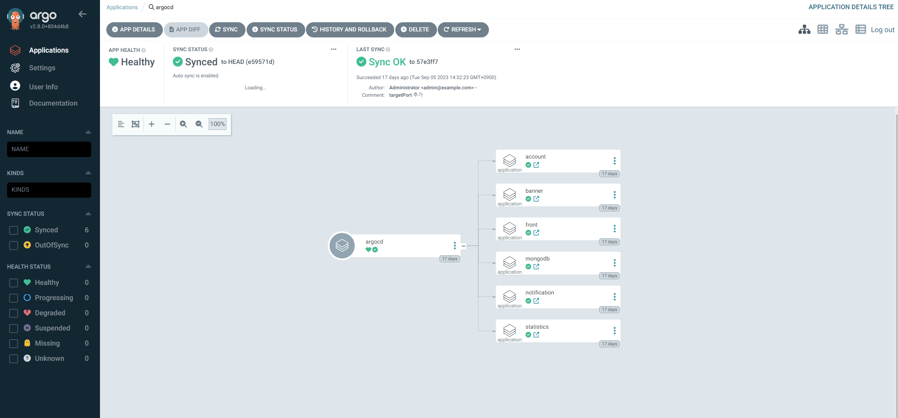

# ArgoCD App of Apps 배포 패턴 v1 (기본 템플릿)

ArgoCD에서 여러 개의 마이크로서비스 Helm 차트를 단 하나의 부트스트랩 매니페스트로 일괄 관리 및 배포하는 **App of Apps 패턴(v1)**의 기본 구성 및 아키텍처 가이드입니다.

---

## 1. 동작 아키텍처 및 디렉터리 흐름

```
[ application.yaml ] (최상위 루트 ArgoCD Application)
         │
         ▼
     [ apps/ ]        (하위 애플리케이션 생성용 매니페스트 모음)
   ├── app-account.yaml
   ├── app-banner.yaml
   ├── app-front.yaml
   └── ...
         │
         ▼
    [ charts/ ]       (실제 서비스별 Helm 차트)
   ├── account/
   ├── banner/
   ├── front/
   └── ...
```

1. **`application.yaml`**: 최상위 ArgoCD App으로, 클러스터에 배포되면 `apps/` 폴더를 바라보고 하위 App들을 일괄 생성합니다.
2. **`apps/`**: 각 하위 서비스별 ArgoCD Application 매니페스트가 위치합니다.
3. **`charts/`**: 실제 쿠버네티스 Deployment, Service 등을 생성하는 Helm 차트들입니다.



---

## 2. 개발 및 테스트 노트

* **실무 경로 참조 주의사항**:
  * 본 v1 버전은 초기 로컬/사설 환경에서 테스트했던 구조라, 리포지토리 URL이나 서브디렉터리 경로 설정에 따라 Sync 에러가 발생할 수 있습니다.
  * 보다 유연한 클러스터 변수 처리와 네임스페이스별 분기 배포가 필요하다면 개선 버전인 **[`appofapp-v2`](../appofapp-v2/)** 또는 **[`test-spring`](../test-spring/)** 디렉터리의 App of Apps 구성을 사용하는 것을 권장합니다.
* **진행 경과**:
  * App of Apps 패턴을 통해 단일 진입점으로 여러 서비스를 동시에 동기화(Sync)하는 기본 동작을 검증 완료했습니다.
