# Argo Rollouts 무중단 배포 가이드 (Blue/Green & Canary)

ArgoCD 환경에서 **Argo Rollouts** 컨트롤러를 도입하여, 기본 Kubernetes Deployment의 롤링 업데이트 한계를 넘어 **블루/그린(Blue-Green)** 및 **카나리(Canary)** 무중단 배포를 구성하고 수동 승인(Promote)과 Istio 트래픽 제어를 연동하는 실무 가이드입니다.

---

## 1. Blue-Green 배포 원리

* **쿠버네티스 기본 기능으로 구성할 경우**:
  * Deployment를 2개 띄워 두고, Service의 `selector` 라벨을 수동으로 번갈아 수정해야 하므로 관리가 번거롭고 실수 위험이 있습니다.
* **Argo Rollouts 도입 시**:
  * `Rollout` CRD를 사용하여 `activeService`와 `previewService`를 지정하면, 새 버전(Green)을 띄워 사전 검증을 마친 후 클릭 한 번으로 무중단 트래픽 전환(Switch) 및 구버전 파드 자동 정리까지 자동으로 제어할 수 있습니다.

---

## 2. Argo Rollouts 컨트롤러 배포 (ArgoCD)

공식 Argo Rollouts Helm 차트를 ArgoCD에 등록하여 배포합니다.

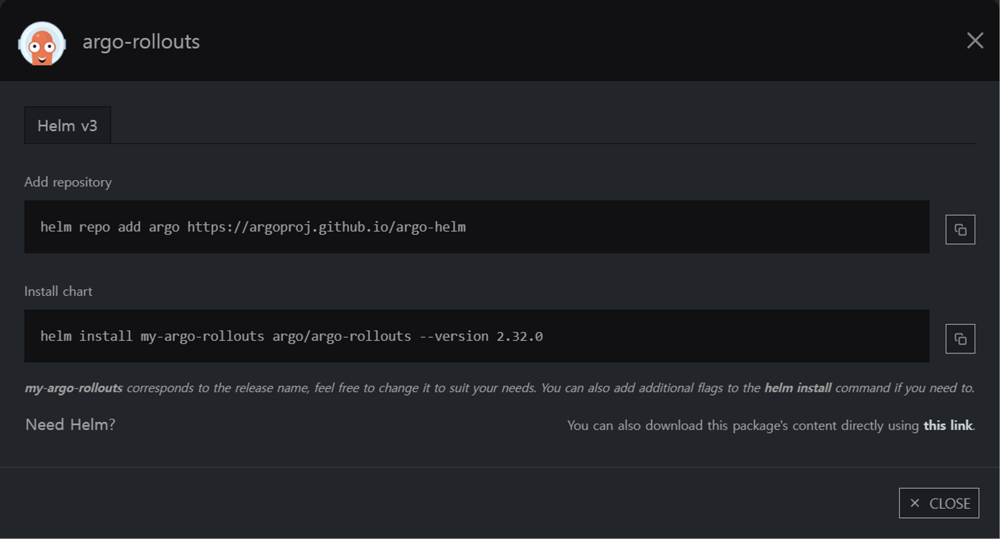
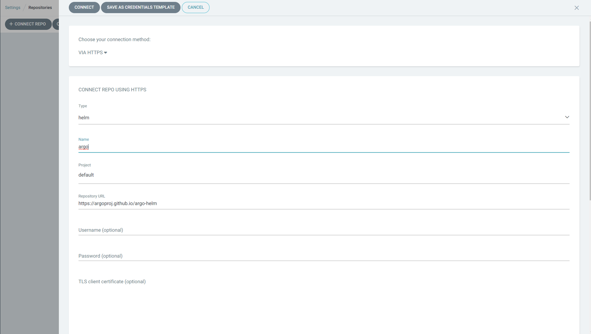
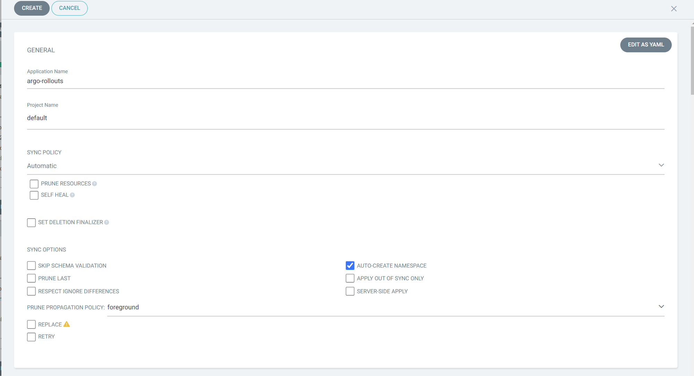
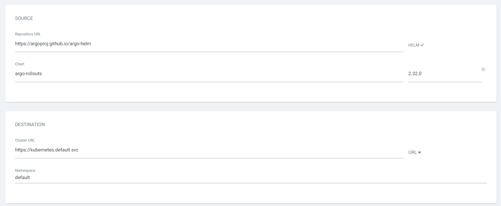
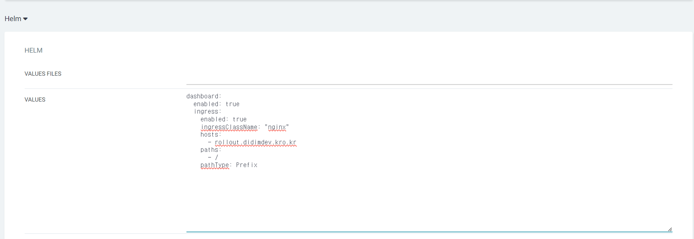
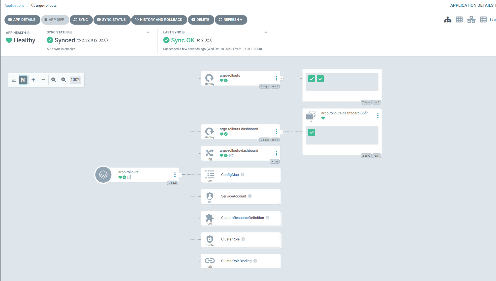

---

## 3. Deployment → Rollout 리소스 전환

기존 `Deployment` 매니페스트의 `apiVersion`과 `kind`를 변경하고, `strategy` 필드에 블루/그린 설정을 추가합니다.

### 1) Kind 변경
```yaml
# 기존
apiVersion: apps/v1
kind: Deployment

# 변경 후
apiVersion: argoproj.io/v1alpha1
kind: Rollout
```

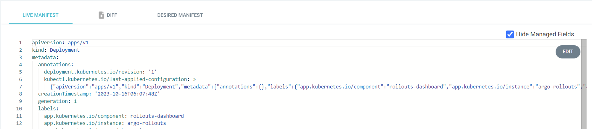
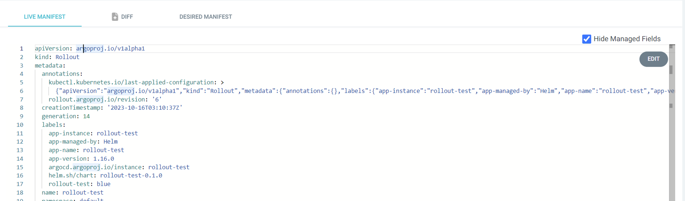

### 2) Blue/Green 전략 정의
```yaml
spec:
  replicas: 3
  strategy:
    blueGreen:
      activeService: rollout-test-blue       # 실제 운영 트래픽을 받는 Service
      previewService: rollout-test-green     # 검증용 테스트 트래픽을 받는 Service
      autoPromotionEnabled: false            # 관리자 수동 승인 후 전환할지 여부
      previewReplicaCount: 1                 # 검증용 프리뷰 파드 개수
      scaleDownDelaySeconds: 3600            # 승인 후 구버전(Blue) 파드를 삭제할 때까지 대기 시간 (1시간)
```

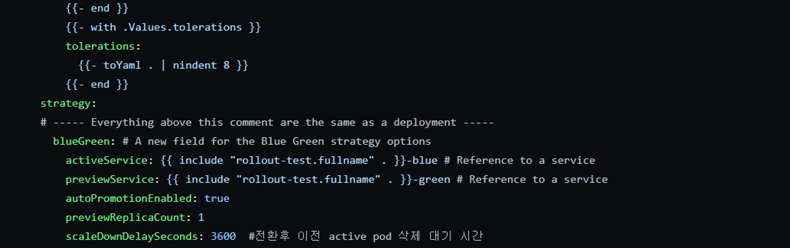

> [!NOTE]
> **Service 구성 주의사항**:
> Blue/Green 배포 시에는 운영 트래픽용 `activeService`와 사전 검증용 `previewService` 등 **2개의 쿠버네티스 Service**가 반드시 미리 배포되어 있어야 합니다.

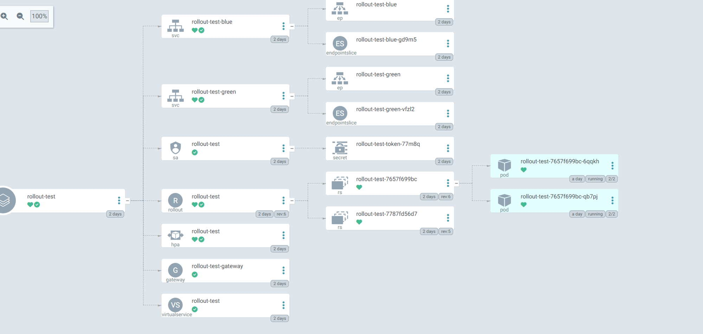

---

## 4. Rollouts 대시보드를 통한 배포 승인 (Promote)

`autoPromotionEnabled: false`로 설정되어 있으면, 새 버전 파드가 정상 기동된 후 대기 상태(Paused)로 머뭅니다.  
Argo Rollouts 대시보드나 CLI에서 **Promote** 버튼을 클릭하면 실제 운영 트래픽이 새 버전으로 일괄 전환됩니다.

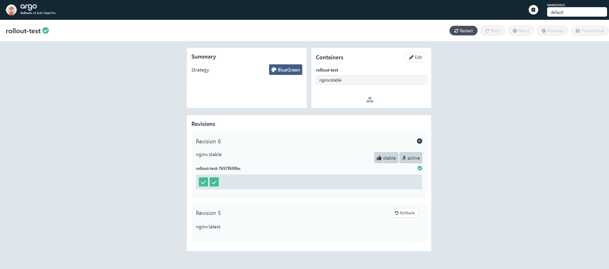

---

## 5. Istio 연동 가중치 카나리 배포 (Canary 50:50 분할)

Istio의 Gateway 및 VirtualService와 연동하면 Blue와 Green 버전에 트래픽을 가중치(50:50 등)로 나누어 점진적으로 전환할 수 있습니다.

### `virtualservice.yaml`
```yaml
apiVersion: networking.istio.io/v1alpha3
kind: VirtualService
metadata:
  name: rollout-test
  namespace: default
spec:
  gateways:
    - istio-system/rollout-test-gateway
  hosts:
    - '*'
  http:
    - route:
        - destination:
            host: rollout-test-blue
          weight: 50
        - destination:
            host: rollout-test-green
          weight: 50
```

### `gateway.yaml`
```yaml
apiVersion: networking.istio.io/v1alpha3
kind: Gateway
metadata:
  name: rollout-test-gateway
  namespace: default
spec:
  selector:
    istio: ingressgateway
  servers:
    - hosts:
        - '*'
      port:
        name: http
        number: 80
        protocol: HTTP
```
