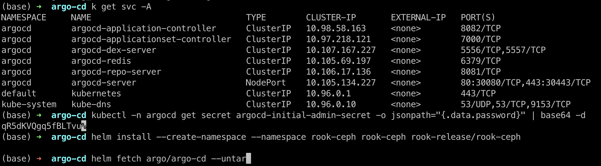
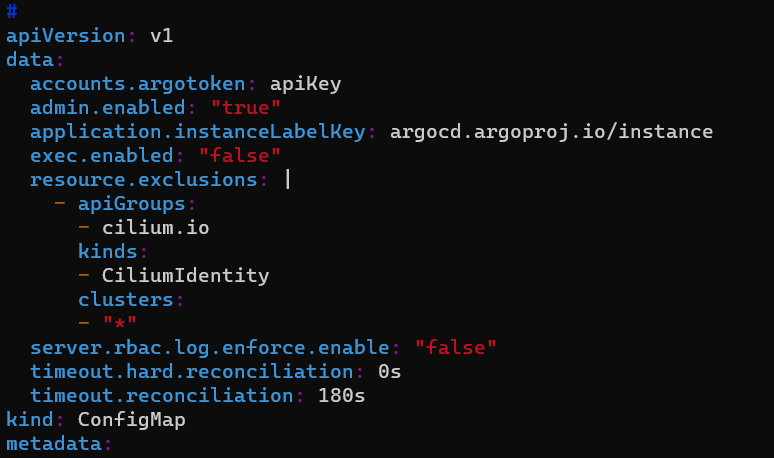
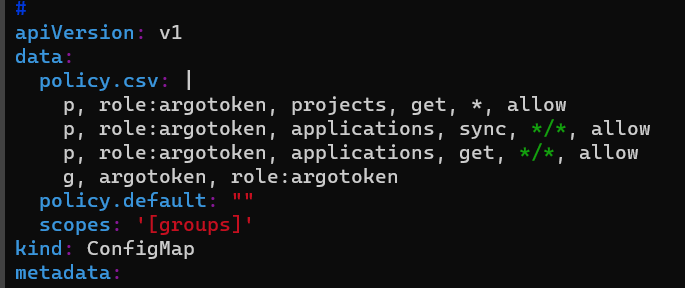

# ArgoCD 설치 및 운영 가이드

ArgoCD를 Kubernetes 클러스터에 배포하고, Private Git 레포지토리 연동, Ingress 설정, 삭제 시 리소스 보존 팁, 그리고 CI/CD 파이프라인에서 자동 Sync를 위한 토큰 발급까지 정리한 가이드입니다.

---

## 1. Helm으로 ArgoCD 설치 (NodePort 접속)

```bash
helm repo add argo https://argoproj.github.io/argo-helm
helm install -n argocd --create-namespace argocd argo/argo-cd --set server.service.type=NodePort
```

---

## 2. 초기 관리자 비밀번호 확인

초기 `admin` 계정의 비밀번호는 Secret에 base64로 저장되어 있으므로 아래 명령어로 디코딩하여 확인합니다.

```bash
kubectl -n argocd get secret argocd-initial-admin-secret -o jsonpath="{.data.password}" | base64 -d
```




---

## 3. Git Private 레포지토리 연동 (SSH Key 방식)

ArgoCD와 Git 레포지토리에 로그인하여 접근 권한을 받아오는 과정입니다.

1. **Connect Repo** 클릭 후 연결 방식을 선택합니다 (HTTPS, SSH, GitHub CLI 중 **SSH** 방식 권장).
2. 레포지토리를 구분할 이름, Git SSH URL, 그리고 Git에 등록한 SSH Key 쌍 중 **Private Key**를 입력하여 접근 가능한지 테스트합니다.


3. **Git 서버 설정**: `ssh-keygen`으로 생성한 키 쌍 중 **Public Key (`.pub`)**를 Git 서버(GitLab/GitHub)에 등록합니다. Private Key를 가진 ArgoCD만 Git 계정에 안전하게 접근할 수 있게 됩니다.


4. Git Clone 주소 중 **SSH 방식의 URL**(`git@...`)을 ArgoCD에 기입하여 등록을 마칩니다.


---

## 4. Ingress 설정 (SSL Passthrough)

gRPC 통신 및 HTTPS 리다이렉트를 정상 처리하기 위해 Ingress NGINX의 `ssl-passthrough` 및 백엔드 프로토콜을 HTTPS로 구성합니다.

```yaml
apiVersion: networking.k8s.io/v1
kind: Ingress
metadata:
  name: argocd-server
  namespace: argocd
  annotations:
    cert-manager.io/issuer: letsencrypt-prod
    nginx.ingress.kubernetes.io/backend-protocol: HTTPS
    nginx.ingress.kubernetes.io/ssl-passthrough: "true"
    nginx.ingress.kubernetes.io/cors-expose-headers: '*, X-CustomResponseHeader'
spec:
  ingressClassName: nginx
  rules:
  - host: argocd.example.com
    http:
      paths:
      - path: /
        pathType: Prefix
        backend:
          service:
            name: argocd-server
            port:
              number: 80
  tls:
  - hosts:
    - argocd.example.com
    secretName: argocd-tls
```

---

## 5. 실무 운영 및 트러블슈팅 팁

### ArgoCD에서 App 삭제 시 Kubernetes 실제 리소스는 보존하고 싶을 때
기본 설정으로 App을 삭제하면 클러스터에 배포된 Deployment, Service 등 하위 리소스가 함께 삭제(Cascading Delete)됩니다.  
ArgoCD 관리 대상에서만 제외하고 **실제 클러스터 리소스는 그대로 살리고 싶다면 삭제 시 `Non-cascading` 옵션을 반드시 체크**하고 삭제해야 합니다.


### 415 Unable to delete resource: Unsupported Media Type 에러 해결
리소스 삭제 시 415 미디어 타입 에러가 발생할 경우, `argocd-server` 배포 설정의 args에 컨텐츠 타입을 명시해 주면 해결됩니다.

```yaml
containers:
  - name: argocd-server
    args:
      - /usr/local/bin/argocd-server
      - '--api-content-types'
      - application/json;application/x-www-form-urlencoded
```

---

## 6. CI/CD 자동 Sync용 ArgoCD Token 생성

GitLab CI나 GitHub Actions 파이프라인에서 빌드 완료 후 자동으로 ArgoCD App Sync를 호출하기 위한 계정 및 토큰 발급 절차입니다.

### 1) ArgoCD 유저 생성
`argocd-cm` ConfigMap을 열고 사용할 서비스 계정을 추가합니다.

```yaml
kubectl edit cm argocd-cm -n argocd

# 아래 내용 추가
data:
  accounts.argotoken: apiKey
```



### 2) 유저 RBAC 권한 부여
`argocd-rbac-cm`에 해당 계정이 App을 조회하고 동기화(sync)할 수 있도록 권한을 설정합니다.

```yaml
kubectl edit cm -n argocd argocd-rbac-cm

# policy.csv에 룰 추가
data:
  policy.csv: |
    p, role:argotoken, projects, get, *, allow
    p, role:argotoken, applications, sync, */*, allow
    p, role:argotoken, applications, get, */*, allow
    g, argotoken, role:argotoken
```


### 3) API Token 발급
```bash
argocd account generate-token -a argotoken
```

### 4) CI/CD 환경변수 등록
GitLab의 경우 **Settings → CI/CD → Variables**에 발급받은 토큰을 `ARGOCD_TOKEN`으로 등록합니다.



### 5) 파이프라인 연동 예시 (GitLab CI)
```yaml
sync-argocd:
  stage: deploy
  image: curlimages/curl:latest
  script:
    - |
      curl -X POST -k -H "Authorization: Bearer ${ARGOCD_TOKEN}" \
        -H "Content-Type: application/json" \
        https://argocd.example.com/api/v1/applications/${APP_NAME}/sync
```
