# GitHub Actions 기반 CI/CD & GitOps 자동화 파이프라인

GitHub Actions를 통해 애플리케이션(Django) 및 프론트엔드 정적 파일(NGINX) 이미지를 자동 빌드/푸시하고, 배포 브랜치(`helm`, `nginx-helm`)의 `values.yaml` 태그를 `sed`로 자동 갱신하여 **ArgoCD가 변경사항을 자동으로 감지해 무중단 배포**하도록 구성한 실무 CI/CD 파이프라인입니다.

---

## 1. CI/CD 전체 아키텍처 흐름

```mermaid
graph TD;

subgraph "GitHub Actions CI"
  A[Main Branch Push] --> B[GitHub Action 실행]
  B --> C[Django 도커 이미지 빌드]
  C --> D[컨테이너 레지스트리 Push]
  D --> F[Helm 브랜치의 values.yaml Tag 자동 변경 및 Push]
end

subgraph "Static 폴더 변경 감지 시 조건부 실행"
  D --> I[Static 변경 감지: Nginx 이미지 빌드]
  I --> J[Nginx 이미지 Registry Push]
  J --> K[nginx-helm 브랜치의 values.yaml Tag 변경]
end

subgraph "ArgoCD GitOps"
  F <--> G[ArgoCD Git Polling & Sync]
  K <--> G
end

subgraph "Kubernetes Cluster"
  G --> H[kubectl apply / 롤링 업데이트]
end
```



---

## 2. 워크플로우 핵심 로직 (`.github/workflows/ci.yml`)

> [!TIP]
> **핵심 자동화 포인트**
> 1. **정적 파일 변경 감지**: `git diff --quiet HEAD^ HEAD -- NWAD/static` 명령어로 정적 리소스에 변경이 있을 때만 NGINX 빌드 잡(`nginx-dockerizing`)이 조건부 실행되도록 `outputs`를 활용합니다.
> 2. **GitOps 태그 자동 반영**: 빌드된 커밋의 Short SHA를 추출하여, 배포용 `helm` 브랜치를 체크아웃하고 `values.yaml`의 `tag:` 값을 `sed`로 치환한 뒤 자동 커밋/푸시합니다.
> 3. **보안**: 레지스트리 인증 키는 GitHub Repository Secrets(`secrets.REGISTRY_ACCESS_KEY`, `secrets.REGISTRY_SECRET_KEY`)로 주입합니다.

```yaml
name: Docker Image CI & GitOps Deploy

on:
  push:
    branches: [ "master", "main" ]
  pull_request:
    branches: [ "master", "main" ]

permissions:
  contents: write

env:
  REGISTRY: cr.example.com
  IMAGE_NAME: django
  IMAGE_NAME2: django-nginx

jobs:
  build-and-push-image:
    runs-on: ubuntu-latest
    outputs: 
      sha_short1: ${{ steps.vars.outputs.sha_short }}
      LOG1: ${{ steps.vars.outputs.LOG }}
      folder_changed1: ${{ steps.folder-changes.outputs.folder_changed }}
      
    steps:
      - name: Checkout Code
        uses: actions/checkout@v4
        with:
          fetch-depth: 2

      - name: Login to Container Registry
        uses: docker/login-action@v3
        with:
          registry: ${{ env.REGISTRY }}
          username: ${{ secrets.REGISTRY_ACCESS_KEY }}
          password: ${{ secrets.REGISTRY_SECRET_KEY }}
          
      - name: Extract Commit Short SHA & Log
        id: vars
        run: |
          echo "sha_short=$(git rev-parse --short HEAD)" >> $GITHUB_OUTPUT
          git log -n 1 --pretty=format:"%s" > log.txt
          echo "LOG=$(cat log.txt)" >> $GITHUB_OUTPUT

      - name: Check for Static Folder Changes
        id: folder-changes
        run: |
          git update-index --refresh
          if git diff --quiet HEAD^ HEAD -- NWAD/static; then
            echo "folder_changed=off" >> $GITHUB_OUTPUT
          else
            echo "folder_changed=on" >> $GITHUB_OUTPUT
          fi        

      - name: Build and Push Django Image
        id: docker_build
        uses: docker/build-push-action@v5
        with:
          push: true
          tags: ${{ env.REGISTRY }}/${{ env.IMAGE_NAME }}:${{ steps.vars.outputs.sha_short }}

      - name: Update Tag in Helm Deploy Branch
        run: |
          git remote update
          git checkout helm

          OLD_TAG=$(cat values.yaml | grep -i "tag:\ " | awk 'NR == 1 {print $2}')
          NEW_TAG="\"${{ steps.vars.outputs.sha_short }}\""
          
          # values.yaml 태그 치환
          sed -i "s#${OLD_TAG}#${NEW_TAG}#g" values.yaml
          
          git config user.name "github-actions[bot]"
          git config user.email "github-actions[bot]@users.noreply.github.com"
          
          git add values.yaml 
          git commit -m "deploy: update image tag to ${{ steps.vars.outputs.sha_short }} - ${{ steps.vars.outputs.LOG }}"
          git push origin helm

  nginx-dockerizing:
    runs-on: ubuntu-latest
    needs: build-and-push-image
    # static 폴더에 변경이 감지되었을 때만 실행
    if: ${{ needs.build-and-push-image.outputs.folder_changed1 == 'on' }}
    steps:
      - name: Checkout Code
        uses: actions/checkout@v4

      - name: Login to Container Registry
        uses: docker/login-action@v3
        with:
          registry: ${{ env.REGISTRY }}
          username: ${{ secrets.REGISTRY_ACCESS_KEY }}
          password: ${{ secrets.REGISTRY_SECRET_KEY }}

      - name: Build and Push Nginx Image
        uses: docker/build-push-action@v5
        with:
          context: .
          file: nginx-Dockerfile
          push: true
          tags: ${{ env.REGISTRY }}/${{ env.IMAGE_NAME2 }}:${{ needs.build-and-push-image.outputs.sha_short1 }}

      - name: Update Tag in Nginx Helm Branch
        run: |
          git remote update
          git checkout nginx-helm  

          OLD_TAG=$(cat values.yaml | grep -i "tag:\ " | awk 'NR == 1 {print $2}')
          NEW_TAG="\"${{ needs.build-and-push-image.outputs.sha_short1 }}\""
          
          sed -i "s#${OLD_TAG}#${NEW_TAG}#g" values.yaml
          
          git config user.name "github-actions[bot]"
          git config user.email "github-actions[bot]@users.noreply.github.com"
          
          git add values.yaml 
          git commit -m "deploy: update nginx image tag to ${{ needs.build-and-push-image.outputs.sha_short1 }}"
          git push origin nginx-helm
```
