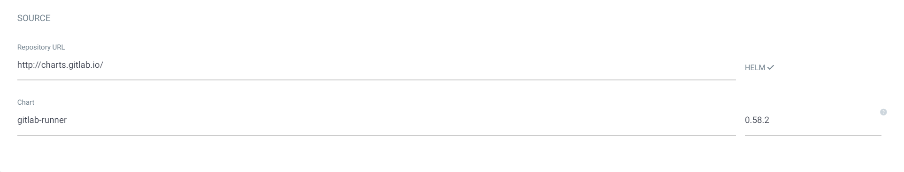

# GitLab Runner Kubernetes 배포 및 Docker-in-Docker(DinD) 설정

Kubernetes 클러스터 환경에서 CI/CD 파이프라인 잡을 동적으로 파드로 띄워 실행하는 **GitLab Runner**의 배포 및 DinD(Docker in Docker) 빌드 환경 설정 가이드입니다.

---

## 1. ArgoCD / Helm 차트 등록

공식 GitLab Runner Helm 차트(`gitlab/gitlab-runner`)를 사용합니다.



---

## 2. `values.yaml` 핵심 설정 (DinD 권한 및 소켓 마운트)

> [!IMPORTANT]
> **Docker 빌드 핵심 설정**
> CI 파이프라인에서 `docker build`를 실행하려면 파드에 `privileged=true` 권한이 부여되거나, 호스트의 `/var/run/docker.sock`을 볼륨으로 마운트해 주어야 합니다.

```yaml
# 연동할 GitLab 인스턴스 URL
gitlabUrl: https://gitlab.example.com

# 러너 등록 토큰 (GitLab Settings → CI/CD → Runners → New Project/Instance Runner에서 발급)
runnerRegistrationToken: "<YOUR_GITLAB_RUNNER_REGISTRATION_TOKEN>"

# 러너가 K8s 파드를 동적으로 생성하고 관리할 수 있도록 RBAC 활성화
rbac: 
  create: true

# Docker-in-Docker 및 호스트 도커 소켓 공유 설정
runners:
  config: |
    [[runners]]
      [runners.kubernetes]
        image = "ubuntu:22.04"
        privileged = true
      [[runners.kubernetes.volumes.host_path]]
        name = "docker-socket"
        mount_path = "/var/run/docker.sock"
        read_only = false
        host_path = "/var/run/docker.sock"
```

---

## 3. 파이프라인 작성 시 필수 팁 (`.gitlab-ci.yml`)

DinD 환경에서 도커 데몬 소켓이 완전히 초기화되기 전에 빌드 명령이 나가면 에러가 발생하므로, `before_script`에 도커 데몬 로딩 대기 루프를 반드시 넣어주는 것이 좋습니다.

```yaml
build-image:
  stage: build
  image: docker:stable-dind
  before_script:
    - docker --version
    # 도커 데몬 소켓이 활성화될 때까지 1초 간격으로 대기
    - until docker info > /dev/null 2>&1; do sleep 1; done
  script:
    - docker build -t my-app:latest .
```
