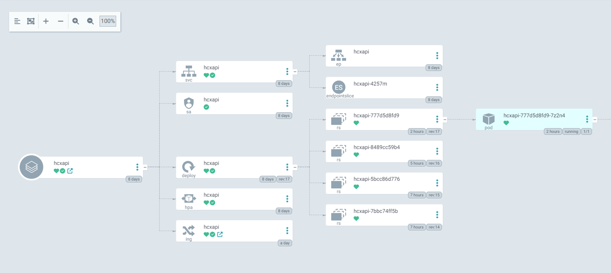

# Istio 서비스 메시 설치 및 핵심 컴포넌트 가이드

Kubernetes 환경에서 **Istio 서비스 메시(Service Mesh)**를 설치하고, 사이드카(Envoy Proxy) 주입, 트래픽 라우팅을 위한 핵심 CRD(Gateway, VirtualService, DestinationRule, Circuit Breaker) 개념과 실습 예제를 정리한 가이드입니다.

---

## 1. Istio 설치 단계

공식 다운로드 가이드: [Istio Getting Started](https://istio.io/latest/docs/setup/getting-started/#download)

### 1) 최신 Istio 다운로드 및 경로 이동
```bash
curl -L https://istio.io/downloadIstio | sh -
cd istio-1.19.3
```

### 2) `istioctl` 바이너리 환경변수 등록
```bash
export PATH=$PWD/bin:$PATH
```

### 3) Istio 데모 프로파일 설치
```bash
istioctl install --set profile=demo -y
```

### 4) 사이드카 자동 주입 (Sidecar Injection) 라벨 추가
파드가 배포될 네임스페이스에 아래 라벨을 지정하면, 해당 네임스페이스에 생성되는 모든 파드에 사이드카 형태로 Envoy Proxy 컨테이너가 자동 주입됩니다.

```bash
kubectl label namespace default istio-injection=enabled
```

---

## 2. 쿠버네티스 기본 컴포넌트 vs Istio 컴포넌트 비교

### 실제 서비스에 필요한 기본 쿠버네티스 컴포넌트
* **Deployment & Service**: 애플리케이션 파드와 내부 통신 엔드포인트를 위한 필수 컴포넌트
* **Ingress**: 클러스터 외부 트래픽을 서비스로 유입시키기 위한 관문
* **HPA (Horizontal Pod Autoscaler)**: CPU/메모리 부하에 따른 자동 스케일아웃
* **ServiceAccount**: 파드가 클러스터 API 권한을 갖거나 클라우드 IAM 권한을 위임받을 때 사용


---

### Istio 도입 시 추가되는 핵심 컴포넌트
Istio를 통해 인입 트래픽을 제어하고 서비스로 라우팅하려면 **Gateway**와 **VirtualService** 2개가 필수적으로 연결되어야 합니다.

* **Gateway**: Istio Ingress Gateway(LoadBalancer)로 들어오는 외부 트래픽의 호스트 및 포트를 제어 (마치 IngressClass / Ingress Host와 같은 역할)
* **VirtualService**: Gateway를 통과한 트래픽을 어떤 쿠버네티스 Service로 보낼지, 헤더 조건이나 가중치(Canary)에 따라 라우팅 경로를 결정
* **DestinationRule**: 파드에 도달하는 트래픽의 서브셋(Subset/버전) 정의, 로드밸런싱 알고리즘, 그리고 이상 파드를 트래픽에서 일시 격리하는 서킷 브레이커(Circuit Breaker)를 설정

> [!NOTE]
> **Argo Rollouts 연동**: Deployment 대신 `Rollout` 리소스를 사용할 경우, Istio VirtualService와 연동하여 카나리 트래픽(10% → 25% → 50% → 100%)을 자동으로 미세 조정할 수 있습니다.



---

## 3. 핵심 매니페스트 예시 코드

### 1) Gateway (외부 트래픽 인입)
```yaml
apiVersion: networking.istio.io/v1alpha3
kind: Gateway
metadata:
  name: bookinfo-gateway
spec:
  # Istio Ingress Gateway 파드를 셀렉터로 지정
  selector:
    istio: ingressgateway 
  servers:
  - port:
      number: 80
      name: http
      protocol: HTTP
    # Ingress의 Host와 동일한 역할
    hosts: 
    - kr.bookinfo.com
```

### 2) VirtualService (헤더 기반 트래픽 라우팅)
특정 헤더가 있을 경우 v2로 라우팅하고, 그 외 일반 트래픽은 기본 v3로 보내는 조건부 라우팅 예시입니다.

```yaml
apiVersion: networking.istio.io/v1alpha3
kind: VirtualService
metadata:
  name: reviews
spec:
  hosts:
  - reviews
  http:
  # end-user 헤더가 'jackson'이면 v2 버전으로 분기
  - match:
    - headers:
        end-user:
          exact: jackson
    route:
    - destination:
        host: reviews
        subset: v2
  # 기본 트래픽은 v3 버전으로 라우팅
  - route:
    - destination:
        host: reviews
        subset: v3
```

### 3) DestinationRule (서킷 브레이커 설정)
연속으로 500대 에러가 발생할 경우 해당 파드로의 라우팅을 일정 시간 차단하는 이상치 탐지(Outlier Detection) 설정입니다.

```yaml
apiVersion: networking.istio.io/v1alpha3
kind: DestinationRule
metadata:
  name: reviews
spec:
  host: reviews
  trafficPolicy:
    outlierDetection: # Circuit Breaker
      consecutiveErrors: 2 # 2번 이상의 500대 에러 발생 시
      interval: 1s         # 1초 주기로 검사
      baseEjectionTime: 3m # 3분간 트래픽 라우팅 풀에서 제외
```
