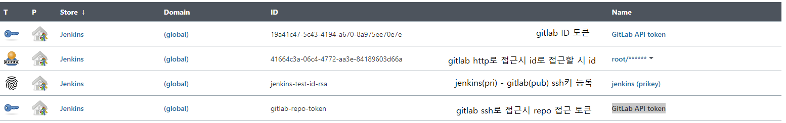

# Jenkins CI/CD 구축 및 GitLab 연동 가이드

컨테이너 및 Kubernetes 환경에서 **Jenkins**를 운영하고, GitLab 레포지토리와 SSH Key / Personal Access Token을 통해 안전하게 연동하여 파이프라인(Pipeline) 빌드를 실행하는 실무 가이드입니다.

---

## 1. Jenkins 실행 방식

### 빠른 로컬 컨테이너 실행
```bash
docker run -d --privileged -p 8080:8080 -p 50000:50000 \
  -v /jenkins:/var/jenkins_home \
  --name jenkins -u root jenkins/jenkins:lts
```

* **Kubernetes Helm 기반 배포**: 클러스터 내 영구 볼륨(PV) 및 ServiceAccount를 구성하여 운영하려면 **[`jenkins_helm/README.md`](jenkins_helm/README.md)** 문서를 참고하세요.

---

## 2. 필수 Credentials 구성 (GitLab 연동)

Jenkins에서 GitLab 저장소의 소스코드를 안전하게 가져오려면 아래 2가지 Credentials 등록이 필수입니다:

1. **GitLab API Access Token**:
   * Jenkins 시스템 설정에서 GitLab 서버 상태 확인 및 웹훅(Webhook) 통신에 사용
2. **Jenkins - GitLab SSH Key 쌍**:
   * Git 소스코드 Clone 시 사용 (`Jenkinsfile` 내 `credentialsId`로 참조)




---

## 3. GitLab Personal Access Token 발급 및 등록

1. GitLab 로그인 → **User Settings → Access Tokens** 메뉴로 이동합니다.
2. 토큰 이름과 유효기간, 필요한 권한(`api`, `read_repository`)을 선택 후 발급합니다.
3. 발급된 토큰 값은 재확인이 불가능하므로 복사해 둡니다.


4. **Jenkins 관리 → Credentials**에서 `GitLab API token` 타입으로 발급받은 토큰을 등록합니다.


---

## 4. SSH Key 등록을 통한 Git Clone 인증

1. Jenkins 컨테이너 내부(또는 호스트)에서 SSH 키를 생성합니다.
   ```bash
   ssh-keygen -t rsa -b 2048 -C "jenkins@example.com"
   ```
2. 공개 키(`cat ~/.ssh/id_rsa.pub`) 내용을 복사하여 GitLab의 **User Settings → SSH Keys**에 등록합니다.


3. 개인 키(`cat ~/.ssh/id_rsa`) 전체 내용을 복사하여 Jenkins Credentials에서 `SSH Username with private key` 타입으로 등록합니다.


---

## 5. 파이프라인(Pipeline) 프로젝트 생성 및 빌드

1. Jenkins 홈에서 **새로운 Item**을 클릭하고 **Pipeline** 타입을 선택합니다.


2. 파이프라인 정의 섹션에서 **Pipeline script from SCM**을 선택하고 SCM을 **Git**으로 지정합니다.
3. GitLab 저장소의 SSH Clone URL(`git@...`)을 입력하고, 위에서 등록한 SSH Credentials를 선택합니다.


4. 레포지토리 내 `Jenkinsfile`의 경로(루트에 위치할 경우 `Jenkinsfile`)를 지정하고 저장합니다.


5. **Build Now**를 클릭하여 파이프라인이 정상적으로 소스를 땡겨와 빌드하는지 확인합니다.
