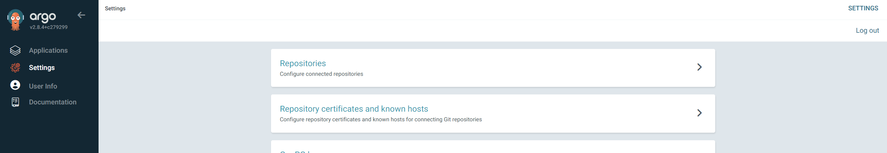

# OpenSearch & OpenSearch Dashboards 로그 수집 시스템 배포 가이드 (ArgoCD)

ArgoCD를 통해 **OpenSearch** 및 **OpenSearch Dashboards** Helm 차트를 등록하고, 단일 노드(Single Node) 개발/운영 환경 구성과 인그레스 연동, 그리고 ArgoCD Helm App 설정 시의 실무 팁을 정리한 가이드입니다.

---

## 1. ArgoCD에 OpenSearch Helm Repository 등록

CLI(`helm install`)로 직접 배포할 수도 있지만, ArgoCD 웹 콘솔에서 Helm Chart Repository를 등록하여 GitOps로 관리하는 방식입니다.

1. **ArgoCD Settings → Repositories**로 진입합니다.
2. **CONNECT REPO** 버튼을 클릭합니다.




3. 저장소 연결 정보를 설정합니다:
   * **Connection Type**: `HELM`
   * **Repository URL**: `https://opensearch-project.github.io/helm-charts`
   * **Name**: `opensearch` (구분하기 쉬운 임의의 이름)
   * **Project**: `default`


---

## 2. OpenSearch Core 배포

1. 등록된 저장소 우측의 점 3개 메뉴를 클릭하고 **Create application**을 선택합니다.


> [!TIP]
> **ArgoCD Application Name 명명 팁**:  
> Application Name에 Chart Name(`opensearch`)을 그대로 기입하는 것이 좋습니다. 이름이 다르면 실제 K8s 리소스명에 Chart Name이 한 번 더 덧붙어(`my-app-opensearch-...`) 이름이 불필요하게 길어지고 난잡해집니다.

2. **Source 설정**: Chart로 `opensearch`를 선택하고 원하는 버전을 지정합니다.


3. **Destination 설정**: 대상 클러스터(`in-cluster`)와 네임스페이스(`monitoring` 또는 `logging`)를 입력합니다. (네임스페이스를 비워두면 에러가 발생하므로 명시 필수).


4. **Values 오버라이드 설정**:  
   단일 노드 테스트 환경인 경우 아래와 같이 `singleNode: true`를 지정합니다.

```yaml
singleNode: true
```


---

## 3. ArgoCD에서 Values 값 수정 팁

배포 후 설정을 변경해야 할 경우 두 가지 방법이 있습니다:

* **APP DETAILS → PARAMETERS**: values.yaml에 노출된 기본 파라미터만 빠르게 수정할 수 있지만, 주석 처리된 복잡한 블록이나 새 필드를 추가하기는 어렵습니다.
* **VALUES 탭 직접 수정 (권장)**: **VALUES** 항목에 커스텀 YAML 전체를 직접 작성하여 덮어쓰는 것이 훨씬 자유롭고 편리합니다.


---

## 4. OpenSearch Dashboards (시각화 콘솔) 배포

동일한 저장소 URL에서 Chart만 **`opensearch-dashboards`**로 선택하여 배포합니다.


### Ingress 연동 Values 설정 예시
```yaml
ingress:
  enabled: true
  ingressClassName: nginx
  annotations:
    cert-manager.io/issuer: letsencrypt-prod
  hosts:
    - host: opensearch.example.com
      paths:
        - path: /
          pathType: Prefix
  tls:
    - secretName: opensearch-tls
      hosts:
        - opensearch.example.com

opensearchHosts: "http://opensearch-cluster:9200"
```
