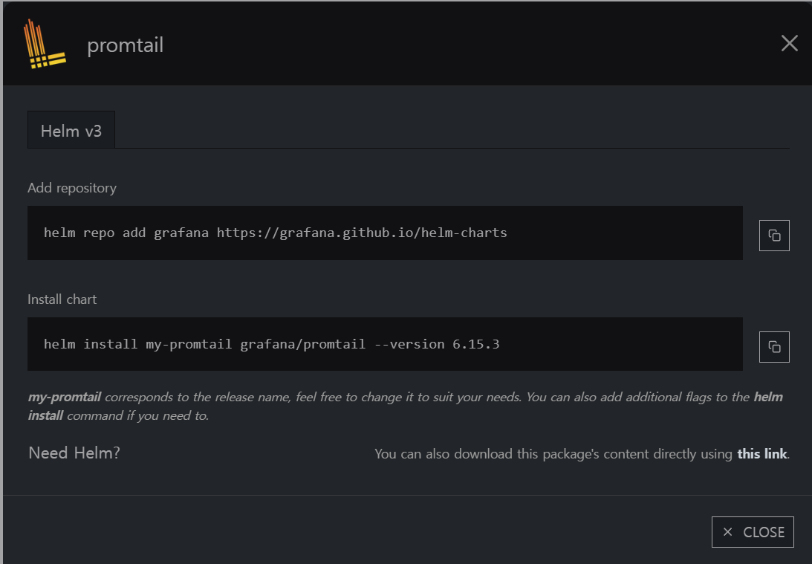

# PLG (Promtail + Loki + Grafana) 경량 로깅 스택 구축 가이드

ELK/EFK 스택 대비 메모리와 인덱싱 리소스 소모가 훨씬 적은 클라우드 네이티브 경량 로깅 시스템인 **PLG(Promtail + Loki + Grafana)** 스택 구축 및 운영 가이드입니다.

---

## 1. 아키텍처 개요

* **Promtail**: 각 노드에 DaemonSet으로 실행되어 컨테이너 로그를 수집하고 필터링/전처리하여 Loki로 전송합니다.
* **Loki-distributed**: 로그 본문 전체가 아닌 레이블만 인덱싱하고, 실제 로그 청크는 S3/오브젝트 스토리지에 압축 저장하여 운영 비용을 획기적으로 절감합니다.
* **Grafana**: Loki를 데이터소스로 연결하여 로그 쿼리(LogQL) 및 메트릭과 연계된 대시보드를 제공합니다.

---

## 2. Promtail 배포 및 수집 필터링 설정

Promtail을 Helm으로 배포할 때, 불필요한 클러스터 시스템 로그나 모니터링 컴포넌트 로그가 대량으로 유입되지 않도록 `pipelineStages`에서 불필요한 네임스페이스를 제외(drop)해 주는 것이 핵심입니다.



```yaml
config:
  clients:
    # Loki Distributed Gateway 주소로 로그 푸시
    - url: http://loki-distributed-gateway.grafana.svc:80/loki/api/v1/push
  enableTracing: true
  snippets:
    pipelineStages:
      - cri: {}
      # 인프라/시스템 네임스페이스 로그는 수집 대상에서 제외 (용량 절감)
      - drop:
          source: "namespace"
          expression: "(appofapps|argocd|cert-manager|default|gitlab|grafana|jupyter|kube-node-lease|kube-public|kube-system|kubecost|logging|otel|prometheus)"
```

---

## 3. Loki-Distributed 배포 (오브젝트 스토리지 연동)

Loki를 마이크로서비스 아키텍처(Distributor, Ingester, Querier, Compactor)로 분리 배포하고 S3 호환 오브젝트 스토리지에 청크를 영구 저장하도록 구성합니다.


```yaml
compactor:
  enabled: true

loki:
  structuredConfig:
    compactor:
      shared_store: s3
    ingester:
      max_transfer_retries: 0
      chunk_idle_period: 1h
      chunk_target_size: 1536000
      max_chunk_age: 1h

    schema_config:
      configs:
        - from: 2020-09-07
          store: boltdb-shipper
          object_store: s3
          schema: v11
          index:
            prefix: loki_index_
            period: 24h

    storage_config:
      boltdb_shipper:
        shared_store: s3
        active_index_directory: /var/loki/index
        cache_location: /var/loki/cache
        cache_ttl: 168h
      filesystem:
        directory: null
      aws:
        endpoint: https://s3.example.com
        region: kr-standard
        bucketnames: "<LOKI_STORAGE_BUCKET_NAME>"
        access_key_id: "<OBJECT_STORAGE_ACCESS_KEY>"
        secret_access_key: "<OBJECT_STORAGE_SECRET_KEY>"
        s3forcepathstyle: true
        insecure: false
        sse_encryption: false
```

---

## 4. Grafana 데이터소스 연동 및 로그 확인

1. Grafana 웹 콘솔의 **Configuration → Data Sources**에서 **Loki**를 추가합니다.


2. Loki Gateway URL(`http://loki-distributed-gateway.grafana.svc:80`)을 입력하고 **Save & Test**를 진행합니다.
3. **Explore** 메뉴에서 LogQL(`{namespace="my-app"}`) 쿼리를 실행하여 실시간 로그가 수집되는 것을 확인합니다.


