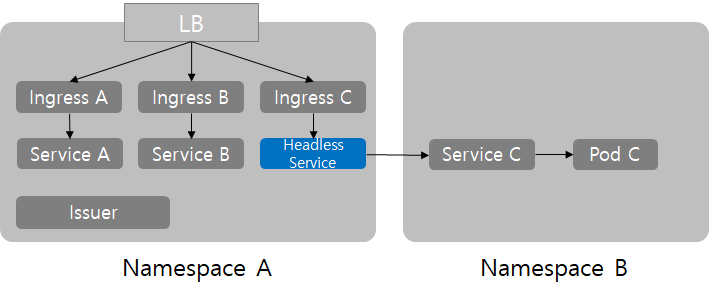

# Ingress NGINX 컨트롤러 설치 및 크로스 네임스페이스 라우팅 가이드

Kubernetes 클러스터에서 표준 외부 인그레스 관문으로 사용되는 **Ingress NGINX** 컨트롤러를 설치하고, 기본 IngressClass 지정, TLS 인증서 연동, 그리고 **다른 네임스페이스에 있는 서비스를 라우팅하는 실무 기법(Cross-Namespace Ingress)**을 정리한 가이드입니다.

---

## 1. Helm으로 Ingress NGINX 설치

```bash
helm repo add ingress-nginx https://kubernetes.github.io/ingress-nginx
helm repo update

# 인그레스 컨트롤러 설치
helm install ingress-nginx ingress-nginx/ingress-nginx --version 4.4.0 -n ingress-nginx --create-namespace
```

---

## 2. Default IngressClass 설정

클러스터 내에서 `ingressClassName`을 명시하지 않더라도 자동으로 `nginx` 인그레스가 적용되도록 기본 클래스로 패치합니다.

```bash
kubectl patch ingressclass nginx \
  --patch '{"metadata":{"annotations":{"ingressclass.kubernetes.io/is-default-class":"true"}}}'
```

---

## 3. 기본 Ingress 및 TLS Secret 매니페스트 예시

```yaml
apiVersion: networking.k8s.io/v1
kind: Ingress
metadata:
  name: ingress-example
  namespace: default
spec:
  ingressClassName: nginx
  rules:
    - host: app.example.com
      http:
        paths:
          - pathType: Prefix
            backend:
              service:
                name: my-service # 같은 네임스페이스 내의 Service 이름
                port:
                  number: 80     # Service 포트
            path: /
  # TLS/HTTPS 활성화 시 작성
  tls:
    - hosts:
        - app.example.com
      secretName: example-tls-secret
```

TLS 인증서 시크릿 예시:

```yaml
apiVersion: v1
kind: Secret
metadata:
  name: example-tls-secret
  namespace: default
type: kubernetes.io/tls
data:
  tls.crt: <BASE64_ENCODED_CERT>
  tls.key: <BASE64_ENCODED_KEY>
```

---

## 4. 실무 팁: 다른 네임스페이스 서비스로 Ingress 연결 (Cross-Namespace Ingress)

### 문제 상황
기본적으로 쿠버네티스 Ingress는 **동일한 네임스페이스에 있는 Service만 백엔드로 참조**할 수 있습니다.  
아래처럼 다른 네임스페이스의 FQDN(`serviceC.namespaceB.svc.cluster.local`)을 직접 백엔드로 적으면 동작하지 않습니다.

```yaml
# ❌ 직접 참조 불가능한 형태
backend:
  service:
    name: serviceC.namespaceB.svc.cluster.local
```

### 해결 방법: ExternalName Service를 브릿지로 활용
Ingress가 위치한 네임스페이스(`namespaceA`)에 `ExternalName` 타입의 프록시 Service를 하나 만들고, 그 서비스가 목적지 네임스페이스(`namespaceB`)의 도메인을 바라보게 한 뒤 Ingress를 연결하면 깔끔하게 해결됩니다.



#### 1) `namespaceA`에 브릿지 서비스 배포
```yaml
apiVersion: v1
kind: Service
metadata:
  name: bridge-to-service-c
  namespace: namespaceA
spec:
  type: ExternalName
  externalName: serviceC.namespaceB.svc.cluster.local
  ports:
    - name: http
      port: 80
      protocol: TCP
```

#### 2) `namespaceA`의 Ingress에서 브릿지 서비스 연결
```yaml
apiVersion: networking.k8s.io/v1
kind: Ingress
metadata:
  name: cross-ingress
  namespace: namespaceA
spec:
  ingressClassName: nginx
  rules:
    - host: app.example.com
      http:
        paths:
          - path: /
            pathType: Prefix
            backend:
              service:
                name: bridge-to-service-c
                port:
                  number: 80
```

* 상세 실습 예제(Rook-Ceph / MinIO 네임스페이스 라우팅 실습): **[`cross-namespace-ingress/README.md`](nginx-ingress_img/cross-namespace-ingress/README.md)**
