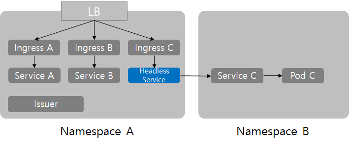

# 크로스 네임스페이스 Ingress 연동 실습 (MinIO Console 연동 예시)

같은 네임스페이스에서 다른 네임스페이스의 Service를 가리키는 `ExternalName` Service를 배포하고, 해당 서비스로 Ingress를 등록하는 구체적인 실무 예시입니다.



---

## 1. 네임스페이스 및 서비스 상태 확인

```bash
# rook-ceph 네임스페이스에 ExternalName 서비스 배포
kubectl get svc -n rook-ceph
# headless-to-minio   ExternalName   <none>   minio-console.minio.svc.cluster.local   9001/TCP   3m19s

# 실제 목적지 네임스페이스(minio)에 배포되어 있는 서비스 목록
kubectl get svc -n minio
# minio           ClusterIP   10.96.244.122   <none>   9000/TCP   10m
# minio-console   ClusterIP   10.96.19.61     <none>   9001/TCP   10m

# Ingress 등록 결과 확인
kubectl get ingress -n rook-ceph
# ceph    nginx   ceph.example.com    80   136m
# minio   nginx   minio.example.com   80   6m59s
# s3      nginx   s3.example.com      80   138m
```

---

## 2. 브릿지 Service 매니페스트 (`svc.yaml`)

`rook-ceph` 네임스페이스에 생성되며, `minio` 네임스페이스의 `minio-console` 서비스를 FQDN으로 가리킵니다.

```yaml
apiVersion: v1
kind: Service
metadata:
  name: headless-to-minio
  namespace: rook-ceph
spec:
  type: ExternalName
  ports:
    - name: minio-console
      protocol: TCP
      port: 9001
  externalName: minio-console.minio.svc.cluster.local
```

---

## 3. Ingress 매니페스트 (`ingress.yaml`)

`rook-ceph` 네임스페이스의 Ingress에서 위에서 만든 `headless-to-minio` 서비스를 백엔드로 연결합니다.

```yaml
apiVersion: networking.k8s.io/v1
kind: Ingress
metadata:
  name: minio
  namespace: rook-ceph
  annotations:
    nginx.ingress.kubernetes.io/enable-cors: "true"
    nginx.ingress.kubernetes.io/cors-allow-headers: "X-Forwarded-For"
    nginx.ingress.kubernetes.io/proxy-read-timeout: "120"
spec:
  ingressClassName: nginx
  rules:
    - host: minio.example.com
      http:
        paths:
          - pathType: Prefix
            backend:
              service:
                name: headless-to-minio
                port:
                  number: 9001
            path: /
```
