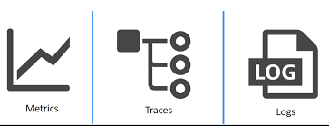

# 쿠버네티스 풀스택 옵저버빌리티(Observability) 가이드

쿠버네티스 클러스터와 분산 마이크로서비스 환경에서 Grafana를 중심으로 수집 및 시각화하는 **모니터링의 세 가지 기둥(Three Pillars: 메트릭, 로그, 트레이스)**의 전체 구성과 각 도구별 역할을 정리한 가이드입니다.

---

## 1. 옵저버빌리티의 세 가지 핵심 축

```
                        [ Grafana 통합 대시보드 ]
                                    │
         ┌──────────────────────────┼──────────────────────────┐
         ▼                          ▼                          ▼
  [ 1. Metrics (메트릭) ]    [ 2. Logs (로그) ]        [ 3. Traces (트레이스) ]
   • Prometheus               • Promtail + Loki (PLG)   • OpenTelemetry
   • Node Exporter            • Fluent Bit + ES (EFK)   • Tempo / Jaeger
   • Kube-state-metrics                                 • Kiali / Pinpoint
```




---

## 2. 메트릭 (Metrics)

클러스터와 노드, 컨테이너의 실시간 수치 데이터(CPU, 메모리, 네트워크, 디스크, 처리량)를 시계열로 수집합니다.


* **Node Exporter**:
  * 각 노드의 CPU, Memory, Disk I/O, Network Traffic 등 베어메탈/VM 호스트 레벨 측정항목 수집
* **Kube-state-metrics**:
  * 쿠버네티스 API 객체(Pod, Deployment, StatefulSet, HPA, PVC)의 상태(생존 여부, 원하는 레플리카 수 대비 현재 파드 수) 지표 수집
* **Kubernetes Control Plane Metrics**:
  * Kubelet, etcd, CoreDNS, kube-scheduler, API 서버의 성능 및 지연 시간 메트릭


---

## 3. 로그 (Logs)

컨테이너의 stdout/stderr 로그와 시스템 감사 로그를 수집하여 장애 분석 및 원인 파악에 사용합니다.

### 1) PLG 스택 (Promtail + Loki + Grafana)
* 로그 본문 전체를 인덱싱하지 않고 라벨 메타데이터만 인덱싱하여 리소스 사용량이 매우 적음
* S3/오브젝트 스토리지에 압축 저장하여 운영 비용이 저렴한 클라우드 네이티브 스택


### 2) EFK 스택 (Elasticsearch / Opensearch + Fluent Bit + Kibana)
* 전문 검색(Full-text Search) 엔진을 기반으로 대규모 로그를 정밀 분석할 때 사용
* 인덱싱 오버헤드가 있으나 복잡한 필터링 및 통계 분석에 유리


---

## 4. 트레이싱 & APM (Traces)

서비스 간 호출 흐름을 Span 단위로 추적하여, 수많은 마이크로서비스 중 어느 구간에서 지연(Latency)이 발생했는지 병목을 시각화합니다.


* **OpenTelemetry + Tempo / Jaeger**:
  * W3C TraceContext 표준을 준수하며, 파드 자동 계측(Auto-Instrumentation)으로 코드 수정 없이 분산 추적 가능
* **Kiali (서비스 메시 토폴로지)**:
  * Istio 서비스 메시 위에서 서비스 간 실시간 mTLS 트래픽 흐름 및 트래픽 양을 시각화


* **Naver Pinpoint**:
  * 바이트코드 인스트루멘테이션 방식으로 Java/Node.js 애플리케이션의 세부 메서드 단위 실행 시간과 SQL 쿼리 성능 추적에 강력
