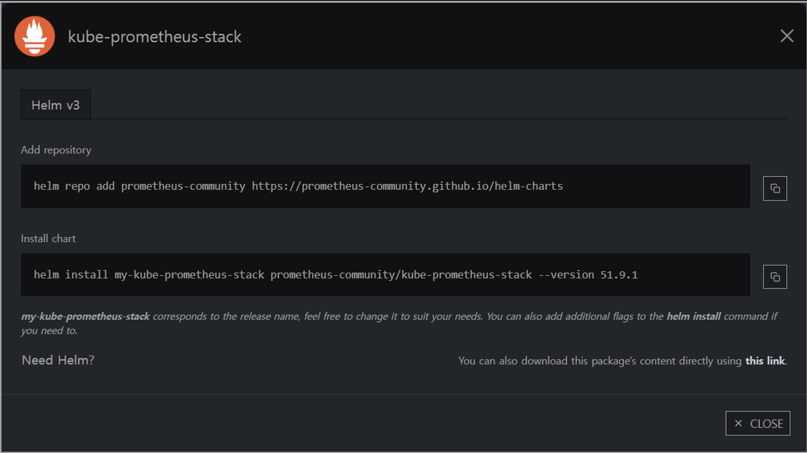
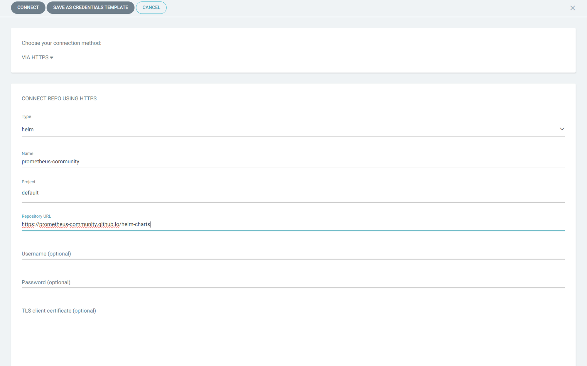
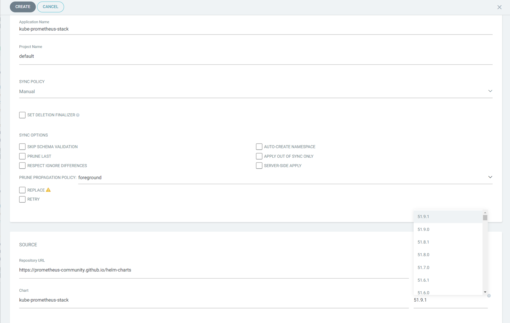
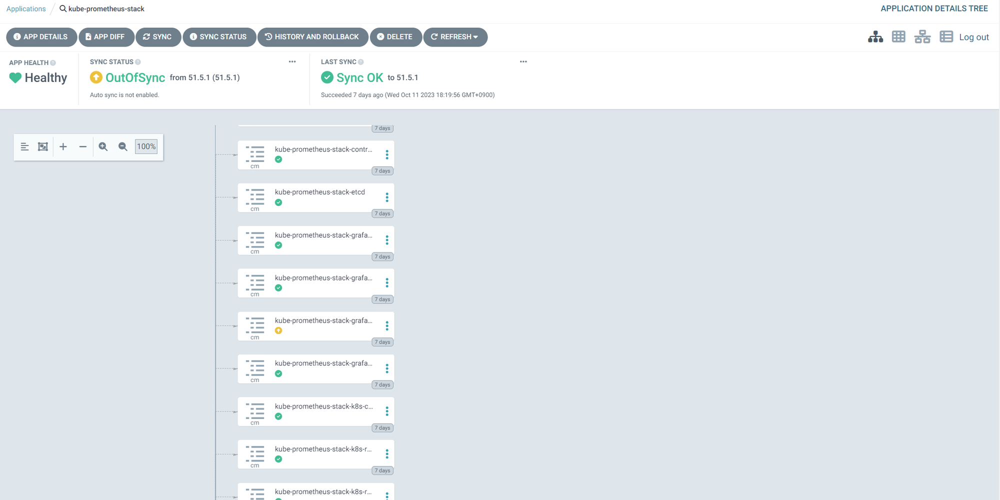
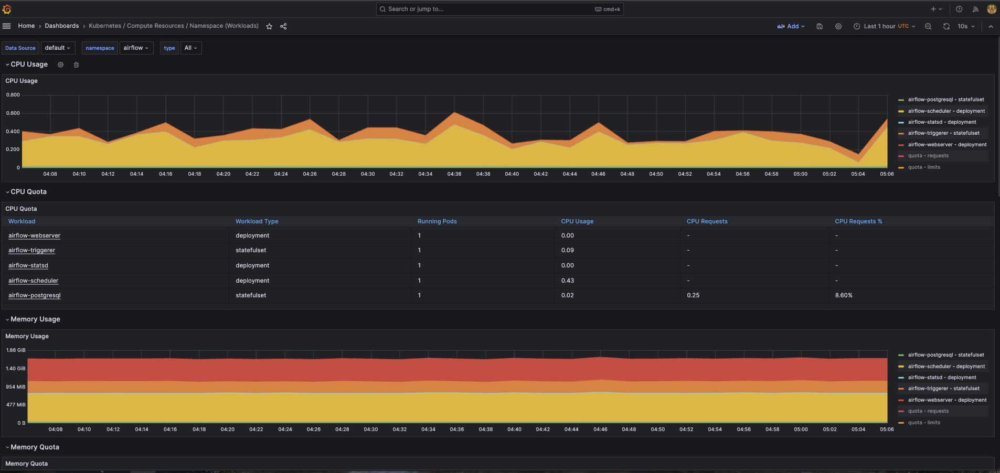

# Prometheus (kube-prometheus-stack) 배포 및 운영 가이드

`kube-prometheus-stack`을 활용하여 Prometheus, Grafana, Alertmanager를 한 번에 구성하고, ArgoCD를 통한 GitOps 배포와 실무 트러블슈팅(CRD Annotation 초과 해결, PVC 영구 저장, Tempo/Loki 데이터소스 자동 연동)을 정리한 가이드입니다.

---

## 1. Helm Repository 등록 및 배포 준비

공식 Prometheus 커뮤니티 Helm 저장소를 사용합니다.

```bash
helm repo add prometheus-community https://prometheus-community.github.io/helm-charts
helm repo update
```



---

## 2. ArgoCD를 통한 GitOps 등록

ArgoCD에 Helm Repository를 등록하고 애플리케이션을 생성합니다.





---

## 3. 실무 values.yaml 핵심 설정

> [!TIP]
> **스토리지 및 데이터소스 유지 주의사항**
> * **스토리지 영구 보존**: Prometheus 기본값은 `emptyDir`이라 파드가 재시작되거나 재배포되면 수집한 시계열 메트릭이 모두 유실됩니다. `storageSpec`에 PVC(30Gi 이상)를 반드시 정의해야 합니다.
> * **Grafana 데이터소스 휘발 방지**: Grafana 재배포 시 Tempo와 Loki 데이터소스가 초기화되지 않도록 `additionalDataSources`에 미리 선언해 둡니다.
> * **Tempo 서비스 그래프 연동**: Tempo에서 Service Graph를 그릴 수 있도록 `enableRemoteWriteReceiver: true`를 활성화합니다.

```yaml
grafana:
  persistence:
    enabled: true
    size: 10Gi
  adminPassword: "<YOUR_GRAFANA_ADMIN_PASSWORD>"
  ingress:
    enabled: true
    ingressClassName: nginx
    annotations: 
      cert-manager.io/issuer: letsencrypt-prod
    labels: {}
    hosts: 
      - grafana.example.com
    path: /
    tls: 
      - secretName: grafana-general-tls
        hosts:
          - grafana.example.com

  # 파드 재기동 시 데이터소스가 초기화되는 것을 막기 위해 사전에 정의
  additionalDataSources: 
    - name: Tempo
      type: tempo
      typeName: Tempo
      access: proxy
      url: http://tempo.grafana.svc:3100
      password: ''
      user: ''
      database: ''
      basicAuth: false
      isDefault: false
      jsonData:
        nodeGraph:
          enabled: true
        tracesToLogs:
          datasourceUid: loki
          filterBySpanID: false
          filterByTraceID: true
          mapTagNamesEnabled: false
          tags:
            - compose_service
      readOnly: false
      editable: true

    - name: loki
      type: loki
      uid: loki
      url: http://loki-distributed-gateway.grafana.svc
      access: proxy
      basicAuth: false
      jsonData:
        serviceMap:
          datasourceUid: 'prometheus'

prometheus:
  prometheusSpec:
    additionalScrapeConfigs:
      - job_name: 'otel-collector'
        scrape_interval: 10s
        static_configs:
          - targets: ['otel-collector.otel.svc:8889']
          - targets: ['otel-collector.otel.svc:8888']

    # Tempo에서 Service Graph 그리기를 위한 원격 쓰기 수신 활성화
    enableRemoteWriteReceiver: true

    # 메트릭 데이터 휘발 방지를 위해 PVC 마운트
    storageSpec:
      volumeClaimTemplate:
        spec:
          accessModes: ["ReadWriteOnce"]
          resources:
            requests:
              storage: 30Gi
```

---

## 4. 실무 트러블슈팅 (CRD Annotation 길이 초과 이슈)

### 이슈 현상
`kube-prometheus-stack`의 CRD(Custom Resource Definition)들은 스키마가 매우 방대하여, `kubectl apply`를 사용할 때 `metadata.annotations`의 `kubectl.kubernetes.io/last-applied-configuration` 크기 제한(256KB)을 초과하면서 아래와 같은 에러가 발생합니다.

```text
The CustomResourceDefinition "prometheuses.monitoring.coreos.com" is invalid: 
metadata.annotations: Too long: must have at most 262144 bytes
```

### 해결 방법: ArgoCD Replace Sync 옵션 활성화
ArgoCD는 기본적으로 `kubectl apply` 방식으로 동기화하므로 위 에러에 걸립니다.  
동기화(Sync) 창에서 **`REPLACE` 옵션을 체크하고 Sync**를 수행하면, `apply`가 아닌 `kubectl replace` 또는 `create` 방식으로 동작하여 에러 없이 정상 배포됩니다.




---

## 5. 배포 완료 및 메트릭 확인

배포 완료 후 Grafana 대시보드에서 파드별, 노드별 CPU/메모리 지난 사용량 추이를 실시간으로 모니터링할 수 있습니다.


