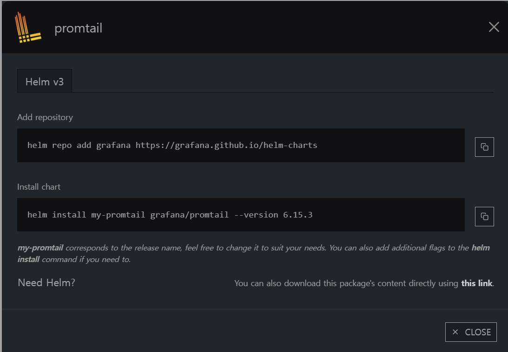
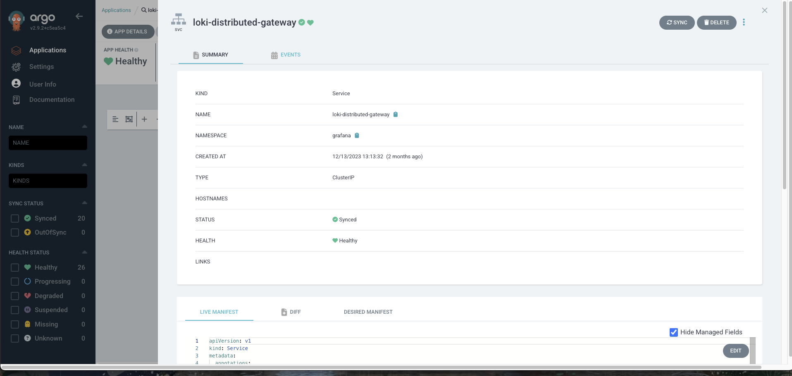

# Promtail 로그 수집기 및 Loki 분산 스토리지 연동 상세 가이드

노드 레벨 로그 수집기인 **Promtail**을 데몬셋으로 띄워 네임스페이스별 로그를 지능적으로 필터링하고, **Loki-distributed**와 S3 호환 오브젝트 스토리지를 연동하여 대규모 컨테이너 로그를 압축 저장하는 상세 설정 가이드입니다.

---

## 1. Promtail 수집 필터링 설정 (`values.yaml`)

각 노드에서 실행되는 Promtail이 파드 로그를 긁어올 때, 수집 대상 네임스페이스를 선별하고 불필요한 시스템/모니터링 로그는 드롭(`drop`)합니다.



```yaml
config:
  clients:
    # Loki Distributed Gateway의 클러스터 내부 도메인과 포트 지정
    # 형식: http://{SERVICE_NAME}.{NAMESPACE}.svc:{PORT}/loki/api/v1/push
    - url: http://loki-distributed-gateway.grafana.svc:80/loki/api/v1/push
  enableTracing: true
  snippets:
    pipelineStages:
      - cri: {}
      # 인프라, 모니터링, 시스템 네임스페이스 로그는 수집 대상에서 제외 (스토리지 절약)
      - drop:
          source: "namespace"
          expression: "(appofapps|argocd|cert-manager|default|gitlab|grafana|jupyter|kube-node-lease|kube-public|kube-system|kubecost|logging|otel|prometheus)"
```

> [!NOTE]
> `/loki/api/v1/push`는 Loki가 로그 데이터를 수신하는 표준 REST API 엔드포인트입니다.



---

## 2. Loki-Distributed 상세 설정 및 S3 연동

Loki를 배포할 때 컴팩터(Compactor)와 오브젝트 스토리지 연동 옵션을 상세 주석과 함께 설정합니다.


```yaml
compactor:
  # 로그가 저장될 때 작은 단위의 조각 파일들이 수없이 생기기보다
  # 하나의 묶음 압축 파일로 합쳐서 관리해주는 필수 컴포넌트
  enabled: true

loki:
  structuredConfig:
    compactor:
      shared_store: s3
    ingester:
      max_transfer_retries: 0
      chunk_idle_period: 1h
      chunk_target_size: 1536000 # 약 1.5MB 단위로 청크 롤링
      max_chunk_age: 1h
    schema_config:
      configs:
        - from: 2020-09-07
          store: boltdb-shipper
          object_store: s3
          schema: v11
          index:
            prefix: loki_index_
            period: 24h
    storage_config:
      boltdb_shipper:
        shared_store: s3
        active_index_directory: /var/loki/index
        cache_location: /var/loki/cache
        cache_ttl: 168h
      filesystem:
        # 파일시스템 동시 사용 시 발생하는 null pointer 에러를 방지하기 위해 비활성화하고 S3만 사용
        directory: null
      aws:
        endpoint: https://s3.example.com
        region: kr-standard
        bucketnames: logs-loki-dev
        access_key_id: "<OBJECT_STORAGE_ACCESS_KEY>"
        secret_access_key: "<OBJECT_STORAGE_SECRET_KEY>"
        s3forcepathstyle: true
        insecure: false
        sse_encryption: false 
```


---

## 3. Grafana 데이터소스 연동 및 로그 검색

1. Grafana 웹 콘솔에서 **Loki Gateway URL**(`http://loki-distributed-gateway.grafana.svc:80`)을 데이터소스로 추가합니다.


2. **Explore** 메뉴에서 레이블 필터(`{app="my-service"}`)를 적용하여 로그가 실시간으로 수집되는 것을 확인합니다.


