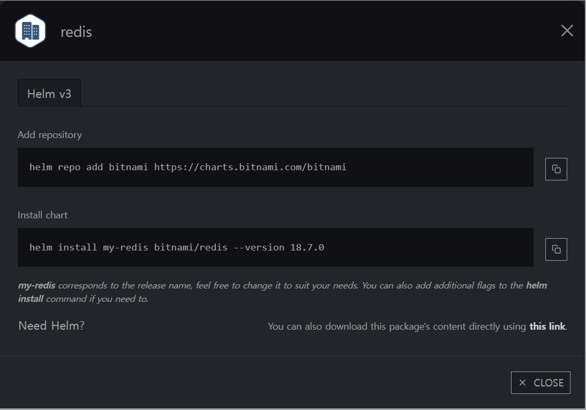

# Redis 배포 및 운영 가이드 (Bitnami Helm)

Bitnami Redis Helm 차트를 사용하여 마스터-레플리카(Master-Replica) 고가용성 구조를 배포하고, Prometheus 메트릭 수집(ServiceMonitor)을 연동하는 실무 가이드입니다.

---

## 1. Helm Repository 등록

```bash
helm repo add bitnami https://charts.bitnami.com/bitnami
helm repo update
```



---

## 2. `values.yaml` 핵심 설정

> [!TIP]
> **모니터링 연동 팁**
> `metrics.enabled: true` 및 `metrics.serviceMonitor.enabled: true`를 설정하면, Prometheus Operator가 Redis 메트릭(연결 수, 메모리 사용량, 초당 처리 명령 수)을 자동으로 수집합니다.

```yaml
global:
  storageClass: ""
  redis:
    password: "<YOUR_REDIS_PASSWORD>"

# 마스터 노드 설정
master:
  persistence:
    enabled: true
    size: 10Gi
  resources:
    requests:
      cpu: "500m"
      memory: "1Gi"
    limits:
      cpu: "1"
      memory: "2Gi"

# 레플리카 (읽기 분산) 노드 설정
replica:
  replicaCount: 2
  persistence:
    enabled: true
    size: 10Gi
  resources:
    requests:
      cpu: "250m"
      memory: "512Mi"
    limits:
      cpu: "500m"
      memory: "1Gi"

# 프로메테우스 모니터링 exporter 설정
metrics:
  enabled: true
  serviceMonitor:
    enabled: true
    namespace: prometheus
    interval: 30s
  prometheusRule:
    enabled: true
```

---

## 3. ArgoCD를 통한 GitOps 배포

작성한 `values.yaml`을 기반으로 ArgoCD Application을 생성하여 클러스터에 배포합니다.


---

## 4. 접속 테스트 명령어

```bash
# Redis CLI 파드 임시 실행 및 접속
kubectl run --namespace default redis-client --restart='Never' --env REDIS_PASSWORD="<YOUR_REDIS_PASSWORD>" --image docker.io/bitnami/redis:latest --command -- sleep infinity

# 마스터 노드 접속 확인
kubectl exec --tty -i redis-client --namespace default -- bash
redis-cli -h redis-master -a $REDIS_PASSWORD ping
# 응답: PONG
```
