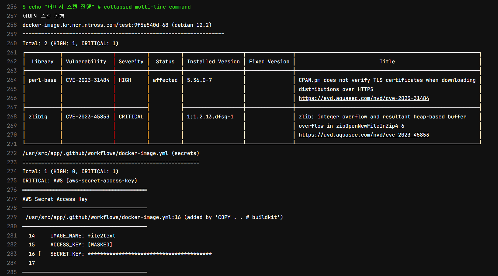

# Trivy 컨테이너 이미지 취약점 스캔 가이드

Aqua Security의 오픈소스 보안 스캐너인 **Trivy**를 활용하여 CI/CD 파이프라인에서 컨테이너 이미지를 빌드한 직후 취약점(Vulnerability)을 자동으로 검사하는 파이프라인 구성 가이드입니다.

---

## 1. 실무 도입 후기 및 아키텍처 팁 (느낀 점)

* **DB 캐싱 전략**:
  * 취약점 검사에 사용되는 Java DB 등 다운로드 용량만 500MB에 달하므로, 매 빌드마다 새로 받으면 파이프라인 속도가 급격히 느려집니다.
  * DB를 미리 다운받아 둔 도커 이미지를 자체 베이스 이미지로 재사용하거나, `.trivycache/` 볼륨을 캐시로 마운트해 사용하는 것이 훨씬 효율적입니다.
* **가벼운 아키텍처**:
  * 별도의 무거운 서버 데몬이 필요 없이 단일 바이너리(CLI Client) 하나만으로 이미지 검사가 가능하여 파이프라인 구성이 매우 단순합니다.
  * 컨테이너 이미지뿐만 아니라 클러스터 내 Kubernetes 리소스의 보안 취약점도 검사 가능합니다.
* **리포트 관리 및 알림 대안**:
  * GitLab 기본 대시보드에서 보안 리포트(Security Dashboard)를 보려면 유료 버전(Ultimate)이 필요합니다.
  * 따라서 무료 버전에서는 `HIGH,CRITICAL` 등급 취약점만 JSON/HTML로 추출하여 별도 보안 관리 레포에 푸시하거나, Slack Webhook으로 알람을 발송하는 방식으로 운영하는 것을 추천합니다.

---

## 2. GitLab CI 파이프라인 연동 (`.gitlab-ci.yml`)

도커 인 도커(DinD) 환경에서 이미지를 빌드하고 Trivy로 스캔한 뒤, GitLab 보안 리포트 규격에 맞춰 JSON을 생성하는 예시입니다.

```yaml
stages: 
  - docker

docker:
  image: docker:stable-dind
  stage: docker
  variables:
    DOCKERFILE_PATH: "./Dockerfile"
    CI_REGISTRY: "cr.example.com"
    APP_NAME: "test"
    TRIVY_VERSION: "0.47.0"
  before_script: 
    # docker.sock 데몬 로딩 대기
    - until docker info; do sleep 1; done
  script:
    - |
      echo "=== 1. 도커 레지스트리 로그인 ==="
      echo ${SECRET_KEY} | docker login -u ${ACCESS_KEY} --password-stdin ${CI_REGISTRY}

    - |
      echo "=== 2. 이미지 태그 설정 ==="
      NEW_TAG=${CI_COMMIT_SHORT_SHA}-${CI_PIPELINE_ID}

    - |
      echo "=== 3. 도커 이미지 빌드 ==="
      docker build -t ${CI_REGISTRY}/${APP_NAME}:${NEW_TAG} .

    - |
      echo "=== 4. Trivy 설치 ==="
      apk add --no-cache curl
      curl -sfL https://raw.githubusercontent.com/aquasecurity/trivy/main/contrib/install.sh | sh -s -- -b /usr/local/bin v${TRIVY_VERSION}

    - |
      echo "=== 5. GitLab Security 템플릿 다운로드 ==="
      curl https://raw.githubusercontent.com/aquasecurity/trivy/main/contrib/gitlab.tpl -o gitlab.tpl

    - |
      echo "=== 6. 이미지 취약점 스캔 진행 ==="
      # 콘솔 요약 출력 (HIGH, CRITICAL 등급 위주)
      trivy image --cache-dir .trivycache/ ${CI_REGISTRY}/${APP_NAME}:${NEW_TAG} -s HIGH,CRITICAL --exit-code 0 --quiet
      # GitLab 리포트용 파일 생성
      trivy image --cache-dir .trivycache/ ${CI_REGISTRY}/${APP_NAME}:${NEW_TAG} --format template --template "@./gitlab.tpl" -o gl-container-scanning-report.json --exit-code 0 > /dev/null 2>&1

    - |
      echo "=== 7. 로컬 캐시 이미지 정리 ==="
      docker rmi ${CI_REGISTRY}/${APP_NAME}:${NEW_TAG} --force

  after_script:
    - docker images

  artifacts: 
    paths: 
      - gl-container-scanning-report.json
    reports:
      container_scanning: gl-container-scanning-report.json

  rules:
    - if: '$CI_COMMIT_BRANCH == "main"'
      when: always
```

---

## 3. 스캔 결과 확인

파이프라인 실행 시 Trivy가 베이스 이미지 및 패키지의 취약점(CVE 번호, 심각도, 패치 버전)을 스캔하여 아래와 같이 요약 출력합니다.


