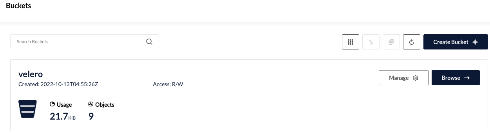

# Velero + MinIO 기반 Kubernetes 클러스터 백업 & 재해 복구(DR) 가이드

온프레미스 또는 로컬 환경에서 S3 호환 스토리지인 **MinIO**를 구축하고, **Velero**를 연동하여 쿠버네티스 리소스 및 볼륨 데이터를 안전하게 백업 및 복원하는 실무 가이드입니다.

---

## 1. MinIO 로컬 오브젝트 스토리지 배포

Velero가 백업 데이터를 저장할 S3 호환 백엔드로 MinIO를 배포합니다.

```bash
helm repo add minio-official https://charts.min.io
helm repo update
```

### `minio-values.yaml` 작성
> [!NOTE]
> MinIO 보안 정책상 Root 사용자 이름은 최소 4글자 이상, 패스워드는 8글자 이상이어야 합니다.

```yaml
replicas: 1
 
minioAPIPort: "9000"
minioConsolePort: "9001"
 
rootUser: admin
rootPassword: "<YOUR_MINIO_ROOT_PASSWORD>"
 
persistence:
  enabled: true
  size: 50Gi
 
service:
  type: NodePort
  port: "9000"
 
consoleService:
  type: NodePort
  port: "9001"
```

```bash
helm install -n minio minio -f minio-values.yaml minio-official/minio --create-namespace
```

---

## 2. MinIO 백업용 버킷 생성

MinIO Console Web UI(`NodePort: 9001`)에 접속하여 로그인한 뒤, Velero가 사용할 버킷인 **`velero`**를 생성합니다.



---

## 3. Velero 배포 및 S3 플러그인 연동

### `velero-values.yaml` 작성
> [!IMPORTANT]
> **실무 주의사항 및 팁**
> 1. **BSL 이름 고정**: `backupStorageLocation.name`은 반드시 **`default`**로 지정해야 합니다 (일부 플러그인 및 하위 버전에서 `default`가 아니면 버그 발생).
> 2. **엔드포인트 주소**: 클러스터 내부 파드 간 통신이므로 NodePort가 아닌 Service의 ClusterIP 주소(`http://minio.minio.svc:9000`)를 지정해야 합니다.

```yaml
initContainers:
  - name: velero-plugin-for-aws
    image: velero/velero-plugin-for-aws:v1.5.1
    imagePullPolicy: IfNotPresent
    volumeMounts:
      - mountPath: /target
        name: plugins

configuration:
  provider: aws
  backupStorageLocation:
    name: default
    bucket: velero
    config:
      region: minio
      s3ForcePathStyle: true
      publicUrl: http://minio.minio.svc:9000
      s3Url: http://minio.minio.svc:9000

credentials:
  useSecret: true
  secretContents:
    cloud: |
      [default]
      aws_access_key_id = admin
      aws_secret_access_key = <YOUR_MINIO_ROOT_PASSWORD>

snapshotsEnabled: false
deployRestic: true

restic:
  resources:
    requests:
      cpu: 500m
      memory: 256Mi
    limits:
      cpu: 1000m
      memory: 1Gi
```

```bash
helm repo add vmware-tanzu https://vmware-tanzu.github.io/helm-charts
helm install -n backup velero -f velero-values.yaml vmware-tanzu/velero --create-namespace
```

---

## 4. MinIO - Velero 연동 상태 확인

Velero 컨트롤러가 MinIO의 S3 버킷에 정상적으로 연결되었는지 확인합니다. `STATUS`가 **`Available`**이어야 정상입니다.

```bash
kubectl get backupstoragelocations.velero.io -n backup
```

---

## 5. Velero CLI 설치 및 백업/복구 실습

[Velero GitHub Releases](https://github.com/vmware-tanzu/velero/releases)에서 OS에 맞는 바이너리를 다운로드합니다.

```bash
# macOS 예시
wget https://github.com/vmware-tanzu/velero/releases/download/v1.9.2/velero-v1.9.2-darwin-amd64.tar.gz
tar -zxvf velero-v1.9.2-darwin-amd64.tar.gz
sudo mv velero-v1.9.2-darwin-amd64/velero /usr/local/bin/

# 네임스페이스 백업 실행
velero backup create nginx-backup1 --namespace backup --include-namespaces nginx-example

# 백업 상태 확인
velero backup describe nginx-backup1 --details
```

백업이 완료되면 MinIO 웹 콘솔의 `velero` 버킷 내에 백업 아카이브(`backups/nginx-backup1/...`)가 생성된 것을 확인할 수 있습니다.


```bash
# 장애 상황 시 복원 명령어
velero restore create --from-backup nginx-backup1
```
